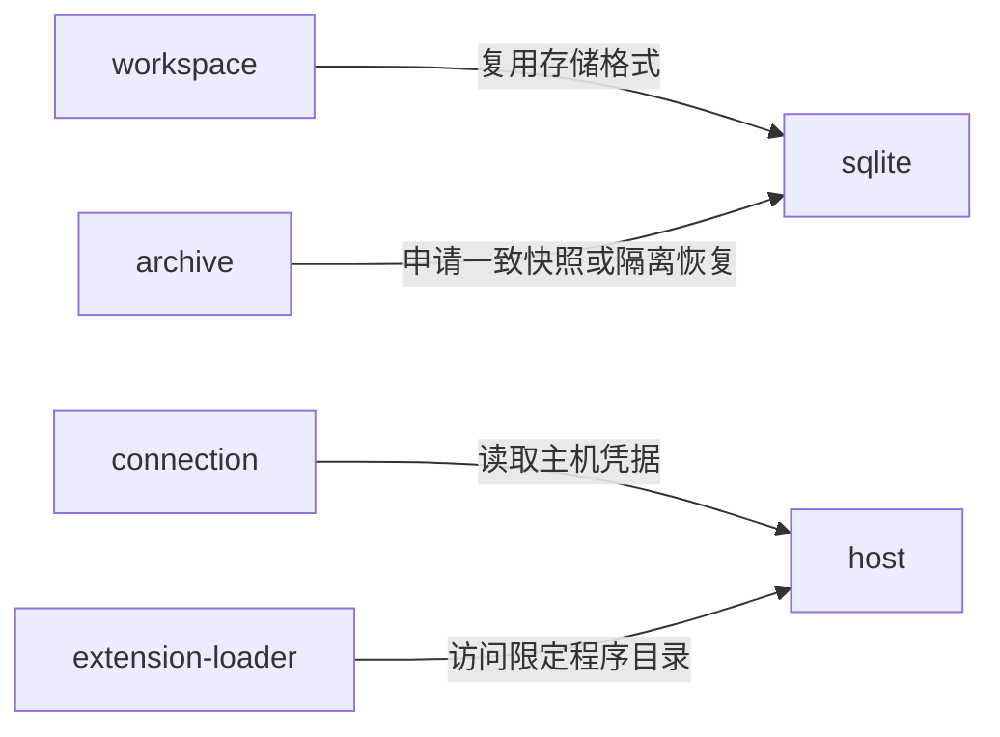

---
paths:
  - "packages/adapters/**/*"
---

# 基础设施适配器

状态：架构基线已于 2026-10-25 经用户确认；源码按 PRD 节点逐项建立，当前实现范围见顶层架构。上级：[共享包](packages.md)。

## adapters

### 架构图

### 定位与职责

将数据库、网络、文件、凭据与程序材料接到核心端口，管理底层资源和错误映射；不决定待办或其他领域的业务结果。

关联 PRD：本机内容持久保存、本机改动上传、统一进度获取、一致快照生成、导出文件交付、工作空间恢复写入、领域程序移除。

### 内部组成

| 子目录 | 职责 |
|---|---|
| sqlite/ | 数据连接、事务、一致快照、隔离恢复及格式迁移的具体存储实现 |
| workspace/ | 权威空间完整创建、原请求核对及初始化服务的 HTTP 客户端 |
| connection/ | HTTP 协议、版本边界、认证携带及连接错误映射 |
| archive/ | 有版本的携带包、清单、校验、完整文件交付和安全解包 |
| host/ | 文件资源、时间与身份生成、主机秘密存储等平台能力 |
| extension-loader/ | 读取与校验扩展包，生成本机程序可用性事实并交给核心管理 |

### 依赖与联动

- sqlite 对外暴露事务和存储端口，不把驱动对象传给 UI、MCP 或领域扩展。
- 同一事务中的内容与接续材料保存在同一个工作空间数据库；不存在凭多个独立文件保存来宣称原子成功的路径。
- archive 从 sqlite 的一致快照读取，不直接复制运行中的裸数据库文件冒充完整导出；包有明确来源、版本和完整性校验。
- 恢复先在隔离目标校验完整材料，再交给核心确认结果；文件交付失败不改变源空间。
- connection 不自行把网络失败解释为业务失败；未知提交结果交由核心核对原操作。
- extension-loader 只安装用户明确提供且校验通过的材料；同步登记不能触发其他主机下载或执行程序。
- host 的凭据实现按宿主选择；秘密不进入普通空间数据包。保存的授权定义与有效秘密分离。

### 架构级约束与不变量

- 文件路径、解包条目及程序移除目标必须处于已授权目录；防止跨目录写删，通过路径边界测试保障。
- SQLite 数据目录只处于本机磁盘，由持有者进程访问；远端调用只经应用服务，禁止网络盘上的多进程共享数据库。
- 验证包完整性不意味着信任其行为；扩展声明仍按能力清单校验，未知或不兼容版本不静默执行。
- 数据库升级只针对当前进程拥有且已备份/校验的格式；领域程序补齐不得隐式迁移业务数据。

### 技术选型与非功能约束

N01 已选用运行时内置 node:sqlite，异步端口将同步数据库操作限定在专用 worker，事务及恢复语义见 [本机保存 TDD](../tdd/local-persistence.md)。已验证 Node.js 22.23.0 与 Electron 45.0.0 内置 Node 24.22.0；安装包验收仍待后续完成。归档容器、清单格式和校验字段在导出节点定义；跨版本可读性与可恢复性优先于沿用数据库内部布局。

N32–N40 已建立 connection/http-sync.ts，以及 sqlite/replication-database.ts 的权威事实/回执、本机确认副本、游标和编辑保护存储。传输适配器不解释领域结果，SQLite 仍运行在 worker；既有格式在事务内增量升级至 v4，源码和验证见 [同步 TDD](../tdd/replication.md)。

N44–N49 将空间 SQLite 增量升级至 v5，承接授权、来源记录、冻结 MCP 请求和服务器程序可用性；N50 提供同一读取事务内的范围统计；N51–N62 增加版本化归档、独立恢复 worker、事务写入门禁及恢复回执，凭据秘密不进入归档，程序可用性在目标重新建立。详见 [数据携带](../tdd/portability.md)。详见 [MCP](../tdd/mcp.md)及[导出范围](../tdd/export-scope.md)。
