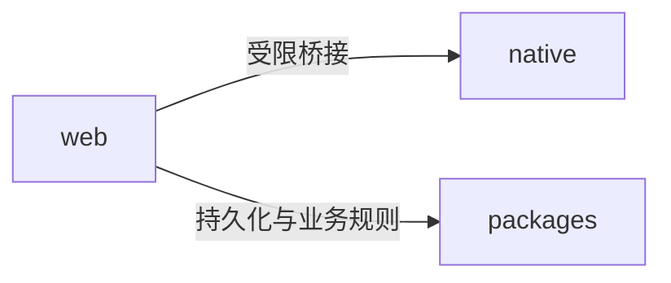

---
paths:
  - "apps/android/**/*"
---
# Android 客户端

## android
### 架构图

### 定位与职责
承接 Android 平台迁移，复用共享领域规则、SQLite 模型、SyncEngine、授权和快照语义。手机入口不依赖其他 apps 的内部模块。
### 内部组成
- web：手机界面、空间目录、领域编排、存储与协议适配。
- native：生命周期、私有 SQLite、加密凭据、后台网络与 SSH、系统文件选择和安装。
### 依赖与联动
web 通过显式平台桥接访问 native；数据库模型直接复用 packages/adapters 的 SQLite 实现，本机副本与权威位置使用不同数据库。本机权威调用 AuthorityService，远程使用原 HTTP 协议。
### 架构级约束与不变量
受信任 WebView 只加载内置资源，禁止外部导航、文件访问与直接网页网络；网络由 native 校验 HTTPS/回环地址。凭据使用 Android Keystore。恢复新建隔离位置，不能覆盖活动空间或自动恢复授权。普通构建关闭调试入口。
### 技术选型与非功能约束
Java、React、WebView；随包 SQLite 统一 JSON/STRICT 能力，JSch 提供 SSH。网络和 SSH 在后台执行。最低声明 Android 8，已测试范围及未完成验收见 apps/android/README.md。
