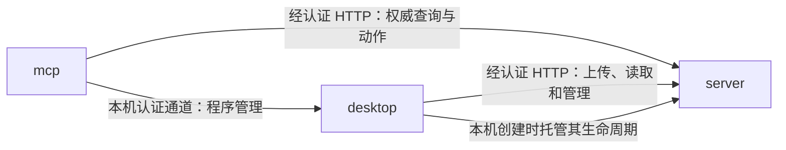

---
paths:
  - "apps/**/*"
---

# 运行入口

状态：架构基线已于 2026-10-25 经用户确认；源码按 PRD 节点逐项建立，当前实现范围见顶层架构。上级：[整体架构](../../../docs/Architecture.md)。

## apps

### 架构图

### 定位与职责

为同一业务内核提供不同运行环境与接入协议。各入口拥有宿主资源和连接状态，不拥有各自独立的领域规则。

关联 PRD：Windows悬浮收录入口、统一位置初始化、已有工作空间接入、MCP工具接入。

### 内部组成

| 子目录 | 稳定职责 | 下级架构 |
|---|---|---|
| desktop/ | 桌面窗口、本机受理和副本同步，以及本机服务进程托管 | [桌面入口](desktop.md) |
| server/ | 权威空间应用宿主、认证和网络受理 | [服务入口](server.md) |
| mcp/ | MCP 协议与领域工具桥接，不包含 Agent 循环 | [MCP 入口](mcp.md) |

### 依赖与联动

- 三个入口分别组装共享包，不能导入另一个入口的内部代码。
- server 不依赖 desktop 的运行；自管服务器可无图形界面启动。
- desktop 本机创建时启动独立 server 宿主，持有进程控制权；退出后的服务生命周期明确呈现，不承诺退出后继续同步。
- mcp 使用独立可撤销授权访问 server，不能复用桌面所有者权限绕过 MCP 范围。
- mcp 的本机程序安装、补齐和移除只发往同一机器上已认证的 desktop 本机管理通道；desktop 不运行或目标不是本机时该能力明确不可用。server 的程序管理只针对 server 自己。

### 架构级约束与不变量

- 应用入口之间只通过边界协议协作，保护独立部署；依赖检查禁止 apps 跨导入。
- 本机服务托管不允许与桌面副本共用一个数据库，保护事实来源；启动配置及集成测试核对数据目录。
- 本机管理通道不可对局域网开放，保护设备程序目录；回环绑定、连接凭据、目标主机身份和请求来源校验共同保障，不能仅信任来源 IP。

### 非功能约束

同一客户端安装包应包含正常启动所需运行资源，不要求普通 Windows 用户先安装 Node.js。独立 server 和 MCP 的开发启动命令与最终分发方式分别提供说明。

