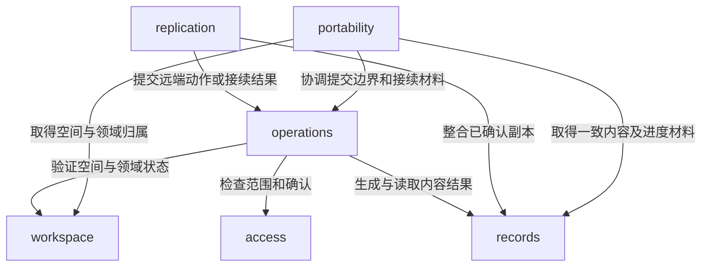

---
paths:
  - "packages/core/**/*"
---

# 共享核心

状态：架构基线已于 2026-10-25 经用户确认；源码按 PRD 节点逐项建立，当前实现范围见顶层架构。上级：[共享包](packages.md)。

## core

### 架构图

### 定位与职责

编排各入口共有的应用行为，管理空间及领域归属、提交结果、同步接续和数据携带；通过注入的领域处理器解释领域数据。

关联 PRD：可靠保存与结果确认、跨设备进度同步、离线记录与补同步、并发修改与冲突处理、信息领域管理、数据自主与迁移、MCP调用记录。

### 内部组成与所有权

| 子目录 | 职责与拥有的事实 |
|---|---|
| workspace/ | 工作空间身份、统一位置绑定、领域登记启用和本机程序可用性分域；内置默认领域只在新建空间时由组装配置提供 |
| records/ | 通用内容身份及封装、已确认进度、删除标记、冲突材料；载荷意义委托领域处理器 |
| operations/ | 人工、同步和 MCP 的动作受理；持有幂等操作结果、待同步成果及业务来源记录的一致提交边界 |
| replication/ | 上传、拉取和重连接续的协调；拥有设备同步游标和调度状态，不拥有权威业务规则 |
| access/ | 所有者及接入授权的范围检查、撤销与具体对象确认请求 |
| portability/ | 按来源导出、恢复隔离和迁移协调；拥有携带包的产品范围及兼容校验决策 |

### 依赖与联动

- operations 有本机受理与权威确认两个明确模式，使用相同领域处理器；模式由宿主组装固定，不能由工具输入随意切换。
- 本机受理把领域结果和待同步操作交给同一事务端口；权威确认把业务结果、去重依据及必要来源记录交给同一事务端口。持久化细节由适配器实现。
- replication 只发送已完整本机受理的操作，收到权威结果后通过核心更新本机成果、冲突与游标；不能在网络回调中直接覆盖数据库内容。
- records 的合并判断使用领域声明及共同已确认依据；发生删除与编辑冲突时保留材料，不由网络到达顺序裁决。
- portability 使用一致快照端口覆盖所选来源内的内容、登记、操作结果、待同步、删除、冲突及调用记录；不拼接多个不一致时点。
- 恢复写入由专用隔离路径执行，不逐条当成新业务动作；历史操作与调用记录不会被重放。未知领域数据作为有归属的原始载荷保留。
- 迁移协调要求旧端停写和目标隔离，与应用生命周期共同控制活动权威角色；不可达旧端沿 PRD 的明确隔离确认路径处理，不凭网络超时推断停用。

### 架构级约束与不变量

| 约束 | 保护目标与涉及模块 | 保障方式 |
|---|---|---|
| 同一次逻辑操作的身份跨本机重启和网络重试保留 | operations、replication | 去重持久化及断点测试 |
| 内容、待同步和冲突材料的更新必须处于完整事务 | records、operations、replication | 事务端口及故障注入 |
| 领域停用不删除内容，程序移除不抹去登记 | workspace、operations、records | 生命周期回归 |
| access 的撤销在实际提交时再次生效 | access、operations | 竞争撤销集成测试 |
| 缺失领域处理器不阻止原始数据保留与导出 | workspace、records、portability | 缺失程序恢复验收 |
| 恢复历史授权不复活凭据效力 | access、portability | 恢复后鉴权测试 |

### 非功能约束

核心仅依赖契约端口及注入能力，不访问环境变量、全局数据库或系统时钟；时间、身份生成等宿主资源通过端口传入。详细状态机、事务 API、字段及恢复算法在对应节点 TDD 定义，不在此预写整套实现。

### 当前实现接续
N44–N49 已建立 access 并接入 operations 的授权、具体确认和来源提交边界；N50–N62 建立 portability 的来源范围和迁移身份/隔离确认边界，宿主组装只读快照、隔离恢复及明确切换端口。详见 [数据携带](../tdd/portability.md)。见 [MCP](../tdd/mcp.md)及[导出范围](../tdd/export-scope.md)。
