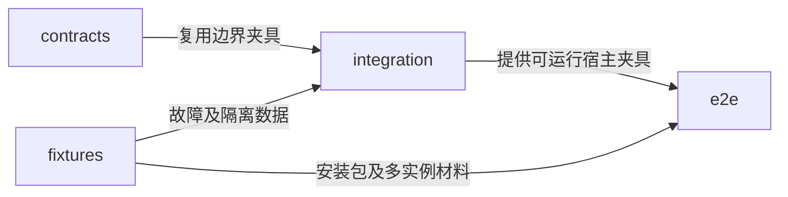
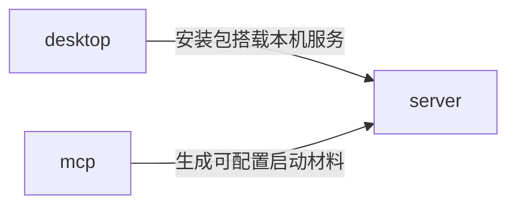

---
paths:
  - "tests/**/*"
  - "deploy/**/*"
---

# 测试与交付边界

状态：架构基线已于 2026-10-25 经用户确认；源码按 PRD 节点逐项建立，当前实现范围见顶层架构。上级：[整体架构](../../../docs/Architecture.md)。

## tests

### 架构图

### 定位与职责

验证跨入口和所有权边界，提供 PRD 所需证据。模块内部计算测试与源码就近组织；本目录承担多个运行入口共同成立的验收。

### 内部组成

| 子目录 | 职责 |
|---|---|
| contracts/ | 领域处理器、存储端口及协议兼容契约验证 |
| integration/ | 事务、重复操作、冲突、权限、扩展及恢复的边界测试 |
| e2e/ | 打包桌面、双客户端、独立服务和真实 MCP 接入验收 |
| fixtures/ | 独立数据目录、故障注入、导出包及扩展样例夹具 |

### 依赖与联动

N01 先验证真实磁盘重启、事务中断和失败不伪报成功；不以纯内存 mock 代替持久化验收。后续按各节点引入有意义的失败、并发与恢复测试。

同步使用两个独立客户端数据目录连接同一个服务数据目录；不让两窗口共用一份数据库假装双设备。MCP 协议测试和真实外部客户端验收分开记录，实际版本与结果明确保留。

### 架构级约束与不变量

测试数据和服务资源必须隔离于用户已有工作空间；不通过自动化清理任意用户目录。故障测试需要覆盖业务结果与接续材料，不只比较 UI 文字。

## deploy

### 架构图

### 定位与职责

提供 Windows 桌面安装材料、独立 server 启动材料与 MCP 桥接配置，维护程序与持久数据分离。

关联 PRD：存放环境管理、已有工作空间接入、MCP工具接入、工作空间数据恢复。

### 内部组成

| 子目录 | 职责 |
|---|---|
| desktop/ | Windows 安装包、内置运行资源和更新时数据目录约定 |
| server/ | 独立服务发行：Ubuntu 安装与 systemd 托管、Windows 启动及恢复入口，程序与数据分离 |
| mcp/ | stdio 服务分发及目标客户端配置示例 |

### 依赖与联动

桌面包搭载本机 server 运行资源；远端服务不依赖桌面安装。Linux 可选容器必须使用持久卷并保持单实例写入。TLS、监听地址及首次所有者引导在服务部署指南中具体化，不要求购买特定云产品。

MCP 桥接只在本机持有连接所需秘密；客户端配置示例不提交真实凭据。程序升级及卸载不把空间数据目录作为可随程序删除的临时文件。

2026-10-28：deploy/desktop 持有独立更新助手；scripts/package-desktop.mjs 生成带版本与架构的 ZIP 及 SHA256。桌面更新只替换程序目录，保留完整旧目录备份，数据目录继续由原宿主管理。Release 标签、应用版本和根清单须一致；GitHub 附件摘要是下载校验来源，源码归档不参与更新。见 [桌面应用更新](../tdd/desktop-update.md)。

### 非功能约束

N62 的 scripts/build-release.mjs 生成 Windows 便携客户端；2026-10-27 将 Node 服务构建拆到独立 scripts/build-server-release.mjs，无需 Electron 即可生成 Ubuntu tar.gz、Windows 服务目录及向后兼容的通用服务目录。deploy/server/ubuntu 与 windows 分别持有系统启动材料，复用同一服务实现。详见 [服务端部署 TDD](../tdd/server-deployment.md)。现有交付包含运行资源、MCP、扩展样例与使用指南；Windows 便携客户端可直接启动而无需开发依赖。交付可执行文件启动及重启验证见 release.test.mjs；实际平台范围见 docs/交付验收.md。

最终交付以实际运行证据为准：Windows 安装启动、重启持久化、双客户端接续、自管服务、独立扩展、真实 MCP 客户端以及数据携带分别验收。架构文件存在、构建通过或开发服务器能运行均不能单独替代这些结果。

