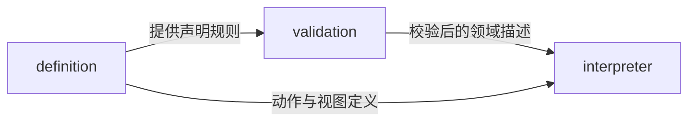
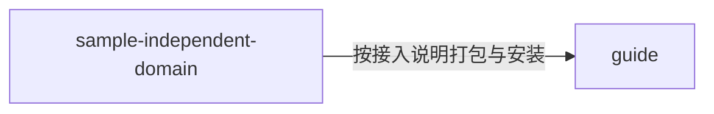

---
paths:
  - "extensions/**/*"
  - "packages/extension-sdk/**/*"
---

# 扩展契约与样例

状态：架构基线已于 2026-10-25 经用户确认；源码按 PRD 节点逐项建立，当前实现范围见顶层架构。上级：[整体架构](../../../docs/Architecture.md)、[共享包](packages.md)。

## extension-sdk

### 架构图

### 定位与职责

让自定义信息类型注册为独立领域，提供主机可解释的数据、视图和动作定义；与 todo-list 保持独立模型。

关联 PRD：领域扩展注册、领域启用状态管理、领域程序移除、领域目录与进入。

### 内部组成

| 规划子目录 | 职责 |
|---|---|
| definition/ | 稳定领域身份、兼容信息及数据、动作、视图、冲突声明规范 |
| validation/ | 包与声明的兼容、结构、范围和引用校验 |
| interpreter/ | 将已校验声明转换为宿主领域处理器及可发现动作 |

### 依赖与联动

首版采用“清单 + JSON Schema + 声明式视图与动作”的扩展包。动作覆盖领域内新增、字段修改、状态转换及删除；宿主负责通用持久化、进度和权限。声明式表单及列表由共享 UI 渲染，业务动作同时可映射 MCP。

此选择让扩展程序能够离线安装、跨主机校验并保留独立数据，不向扩展开放原始 SQL、系统路径、任意脚本或跨领域读写。它是本次架构建议，不把任意 Node.js、原生库和第三方网络同步脚本说成已支持；以后引入可执行插件需要另建受限执行器与权限端口，不可直接在主进程 require 用户代码。

内置 todo-list 作为单独 TypeScript 领域包实现已有专属行为，遵循相同领域处理器边界。SDK 的通用声明不能把 todo-list 字段设为每个领域必填。

### 架构级约束与不变量

- 领域稳定身份及兼容信息由核心核对，插件清单不能自称拥有另一领域已有数据。
- 声明式动作只能作用于当前领域和被授权对象；核心在最终提交时再次核对。
- 扩展不能通过界面模板注入宿主脚本或 HTML；模板只允许宿主认可的组件和可序列化属性。
- 核心进度和来源材料由宿主管理，扩展不可伪造权威确认或删除操作记录。
- 新增领域的声明不能自动安装至其他设备或服务器；各端缺程序时沿既定可用性规则呈现。

### 当前实现

N07–N10 已建立 extension-sdk 的声明校验、适配器的本机程序材料管理、核心登记生命周期和桌面声明式表单。单文件 JSON 使用受限 JSON Schema 2020-12，完整契约与失败恢复见 [领域登记 TDD](../tdd/domain-registration.md)。样例及指南位于 extensions/；联网同步、MCP 发现及导出恢复继续按其节点验收。

### 技术选型

声明采用可版本化数据格式，具体 JSON Schema 版本、动作表达能力与包结构在 N07 JIT TDD 中锁定。若实际验证样例无法满足独立领域的完整操作，须在进入该节点实现时修改本架构建议，不通过暗中加入任意脚本执行规避边界。

## extensions

### 架构图

### 定位与职责

交付一个独立于待办字段的最小扩展样例及作者指南，验证扩展机制而不新增正式产品领域。

### 内部组成

| 规划子目录 | 职责 |
|---|---|
| sample-independent-domain/ | 独立内容字段、视图、合法动作及兼容性材料的最小包 |
| guide/ | 扩展编写、校验、安装、补齐、启停和跨主机使用说明 |

### 依赖与联动及非功能约束

样例遵守 SDK，不导入 todo-list。验收覆盖桌面视图、服务器校验、MCP 工具发现、本机离线、缺失程序、停用、移除及导出恢复。样例代码可随仓库交付，但它的登记与执行仍需显式安装；不能因为仓库存在样例就让所有新空间默认启用。

