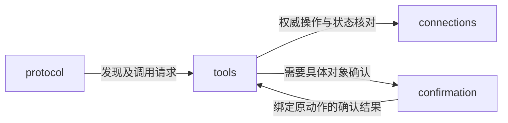

---
paths:
  - "apps/mcp/**/*"
---

# MCP 入口

状态：架构基线已于 2026-10-25 经用户确认；源码按 PRD 节点逐项建立，当前实现范围见顶层架构。上级：[运行入口](apps.md)。

## mcp

### 架构图

### 定位与职责

向外部 Agent 暴露工作空间及领域能力，将 MCP 协议映射到既有应用动作。外部客户端负责语音、文字、模型推理及工具编排。

关联 PRD：MCP接入授权、MCP内容查询工具、MCP内容操作工具、MCP领域管理工具、MCP调用记录。

所有权：MCP 会话与协议协商归本入口；内容事实、范围授权、待确认动作和调用记录归服务侧核心。本入口无独立内容数据库。

### 内部组成

| 子目录 | 职责 |
|---|---|
| protocol/ | 官方 SDK 会话、能力协商与 stdio 协议 |
| tools/ | 根据当前可用领域能力生成工具目录及路由 |
| connections/ | 连接指定权威服务及当前主机管理端，保存最小连接状态 |
| confirmation/ | 外部客户端用户确认的能力协商与转交 |

### 依赖与联动

- 工具目录来自工作空间当前登记、启用、授权和程序可用性；不能根据 Agent 输入的工具名动态扩大权限。
- 通过 HTTPS 或受保护的回环 HTTP 访问统一位置；权威内容查询不混入桌面未同步成果。
- 成功结果只能来自统一位置已确认结果；网络结果不明时核对原操作，不能换身份重新执行。
- 程序管理明确当前主机目标：本机桌面管理通道只管理该机，server 管理端只管理服务器。缺少通道时明确不可用，不声称已移除其他机器程序。
- 调用结果与来源记录由服务事务维护；本入口的 stderr 诊断不代替业务审计。

### 架构级约束与不变量

- stdio 的 stdout 只输出 MCP 消息；诊断写 stderr，避免污染协议。
- 内容权限、领域管理权限和设备本机程序权限独立校验；备份恢复迁移不自动成为已授权工具。
- 删除等动作由服务建立绑定具体对象及当前进度的待确认请求；确认完成后仍须复核对象进度。
- 优先使用客户端声明支持的 MCP elicitation，在独立于模型工具参数的用户交互中承接确认。不能用工具参数里的“用户已确认=true”或 Agent 自述生成确认凭据。
- 客户端不支持可靠的确认交互时，返回由所有者身份验证的确认页面路径作为兼容入口；不要求定位本软件业务窗口。未完成确认保持待确认，不降级为自动执行。目标客户端支持程度必须实测。
- 服务只能在信任接入客户端正确承接用户交互的边界内接受 elicitation 回应；不声称 MCP 能密码学证明客户端背后一定是人。

### 技术选型与非功能约束

采用官方 TypeScript MCP SDK 的受支持发行版，进入 M3 时锁定协议和 SDK 版本。首版交付 stdio MCP 服务进程，可连接本机或远端工作空间；不额外要求公开 Streamable HTTP 服务。

[传输规范](https://modelcontextprotocol.io/specification/2025-11-25/basic/transports)支持 stdio；[elicitation 规范](https://modelcontextprotocol.io/specification/2025-11-25/client/elicitation)把用户交互交给客户端。是否支持这些可选能力由初始化协商和实际客户端验收决定，不能凭客户端名称推定。

### 当前实现
N44–N49 已建立 protocol、tools、connections、confirmation 四个直接模块。使用官方 SDK 1.32.2 的 stdio 桥接，通过服务应用协议访问权威内容和独立管理能力；不持有独立业务库。当前提供服务器声明式程序管理，桌面主机目标明确不可用。具名客户端兼容性不作未测声明，具体契约与验收见 [MCP TDD](../tdd/mcp.md)。
