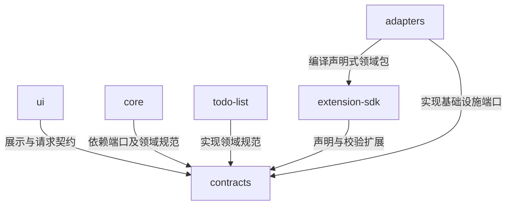

---
paths:
  - "packages/**/*"
---

# 共享包

状态：架构基线已于 2026-10-25 经用户确认；源码按 PRD 节点逐项建立，当前实现范围见顶层架构。上级：[整体架构](../../../docs/Architecture.md)。

## packages

### 架构图

应用入口将各包注入组装；图中没有 core 到 adapters 或到 todo-list 的反向绑定。

### 定位与职责

保持共享机制、领域业务和运行环境分离，避免以 todo-list 作为所有类型的基础模型。

关联 PRD：统一进度保障、todo-list、信息领域管理、数据自主与迁移。

### 内部组成

| 子目录 | 稳定职责 | 下级说明 |
|---|---|---|
| contracts/ | 版本化边界数据、领域处理器规范及存储、网络、文件、凭据端口 | 本层模块边界，具体契约按 JIT TDD 落实 |
| core/ | 空间、内容操作、进度接续、授权和数据携带的应用编排 | [共享核心](core.md) |
| adapters/ | 数据库、连接、文件包、宿主凭据和扩展材料的具体实现 | [适配器](adapters.md) |
| todo-list/ | 独立待办模型、合法动作、显示判定和冲突适配 | 模块边界在本层，细节按待办节点 JIT TDD 落实 |
| ui/ | 宿主无关的工作空间管理、状态反馈及声明式领域组件 | 模块边界在本层，交互以 PRD 为准 |
| extension-sdk/ | 扩展声明规范、校验和领域动作解释器，供主机加载用户包 | [扩展交付](extensions.md) |

### 依赖与联动

- core 消费 contracts 的端口和领域处理器，不感知具体数据库、Electron 或待办字段。
- todo-list 自己解释任务文字、日期、完成、显示和可合并属性；所有其他包使用其声明，不复制规则。
- 递归待办的父级、排序、集合合法性及子树动作继续由 todo-list 拥有；core 仅组织通用多记录提交，adapters 只执行事务和版本检查。服务和 MCP 调用同一领域集合校验，renderer 不成为层级事实所有者。
- extension-sdk 将自定义声明编译成同一种领域处理器；内置 todo-list 与用户扩展遵循同一行为边界，但不要求包内容格式相同。
- ui 使用视图和动作契约；业务动作交给宿主端口，不直接调用持久化适配器。
- adapters 实现端口；contracts 不导入实现包，避免接口与实现循环。
- contracts 不是 PRD 的替代事实源，字段、Schema 与兼容迁移只在实际实现后有具体锚点。

### 架构级约束与不变量

- contracts、core、todo-list 和 extension-sdk 的计算部分不导入宿主 API；用依赖检查和双宿主测试保持可移植性。
- todo-list 不作为 core 或其他领域的基类；以独立数据模型扩展样例验收。
- 领域处理器负责数据意义和动作有效性；核心拥有通用身份、进度与提交秩序。禁止任一方重复拥有对方的决策。
- UI 和 MCP 采用同一动作声明及核心受理结果；跨入口测试检查行为一致。

### 技术选型与非功能约束

共享 TypeScript 包编译后供 Node 和 Electron 宿主使用；UI 单独承担 React 依赖。版本化契约的兼容判断是接入门禁，不能靠同仓开发假设所有设备同步升级。

