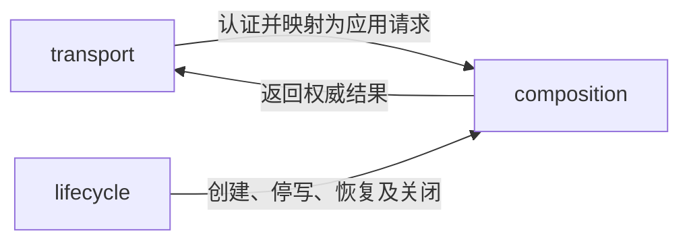

---
paths:
  - "apps/server/**/*"
---

# 权威服务入口

状态：架构基线已于 2026-10-25 经用户确认；源码按 PRD 节点逐项建立，当前实现范围见顶层架构。上级：[运行入口](apps.md)。

## server

### 架构图

### 定位与职责

作为工作空间唯一权威写入宿主，对桌面同步与 MCP 桥接提供同一应用能力。拥有服务进程、监听地址、数据库连接和当前运行模式。

关联 PRD：统一位置初始化、已有工作空间接入、跨设备进度同步、MCP内容操作工具、统一位置迁移切换。

### 内部组成

| 子目录 | 职责 |
|---|---|
| transport/ | HTTP 请求认证、边界校验和应用结果映射 |
| composition/ | 组装权威模式核心、领域处理器与适配器 |
| lifecycle/ | 数据目录锁定、服务启停、恢复隔离和迁移停写 |

### 依赖与联动

- transport 不直接写数据库，不因调用来源不同另建业务执行器。
- composition 将核心的权威模式接到本机 SQLite；同机桌面访问也经过服务受理边界。
- 生命周期模块控制可写状态，核心每次提交在有效写事务中核对该状态；不能仅靠 UI 隐藏入口停写。
- 备份读取、恢复准备和迁移停写由核心携带数据能力请求；lifecycle 与存储适配器提供执行门禁。
- 服务安装了某领域的兼容处理器后，才能确认该领域的业务写入；缺失处理器时保留已有原始数据，可列出不可用状态、导出和补齐程序，不能猜测业务规则。
- HTTP 框架通过入口端口隔离，契约版本不能隐含绑定 Electron 版本。

### 架构级约束与不变量

- 单个数据目录只允许一个权威服务实例写入；保护权威身份，使用进程锁、数据库事务和启动校验。
- 内容结果、操作去重材料、必要审计关联在同一工作空间事务提交；保护重试和追溯，使用断点故障测试。
- 同步输入和 MCP 输入均重新验证领域、授权、进度与迁移状态；保护服务边界，不能信任客户端已经校验。
- 备份恢复的旧授权定义与记录不等于可用凭据；目标的认证材料须重新建立并由当前所有者激活。
- 初始所有者接入只能经受保护的本机初始化或一次性部署引导建立，不能存在公网无认证“认领空间”入口。

### 当前实现

N05 已建立 transport、composition、lifecycle 三个直接模块，仅提供所有者认证的初始化和身份查询。目录独占租约由 SQLite 持有，进程关闭即释放；创建发布由工作线程完成。N32–N40 增加经过所有者认证的同步上传及进度获取，由 composition 组装领域处理器、核心权威执行器与同目录 SQLite 端口；transport 不访问原始数据库。N44–N49 已增加独立接入授权的 MCP 应用协议与所有者管理协议，调用与内容结果共事务；N50–N62 增加所有者只读范围/快照和明确停写/启用管理；恢复由隔离 worker 或随包 CLI 准备，恢复目标在显式迁移启用前拒绝写入。同期修正自动服务端口选择，避免分配至网络客户端拒绝的低位端口。见 [数据携带](../tdd/portability.md)。

### 技术选型与非功能约束

Node.js LTS 承载无界面服务，Windows 和 Linux 为首版服务运行目标。单实例 SQLite 位于本地持久磁盘；HTTP 可置于 TLS 反向代理之后。日志、监听和凭据由部署配置控制，默认本机回环，不默认公网开放。

