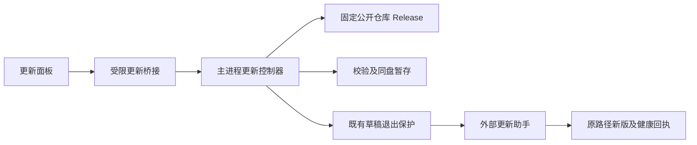

---
paths:
  - "apps/desktop/**/*"
  - "deploy/desktop/**/*"
  - "scripts/build-release.mjs"
  - "tests/e2e/desktop-update.test.mjs"
---

# 桌面应用更新

## 模块概览与架构图

关联 PRD：桌面应用更新、正式版本发现、更新安装与接续。架构位置：desktop host/bridge/renderer 与 deploy/desktop。

实现锚点：`host/desktop-update.ts` 下载及状态协调；`host/update-policy.ts` 版本/附件选择；`bridge/update-contracts.ts` 状态契约；`renderer/app-update.tsx` 展示；`deploy/desktop/update-helper.ps1` 解压、替换及回退；`scripts/build-release.mjs` 生成同源版本信息。

## API 概览

仅暴露 status/check/download/install 四个动作；renderer 不提供 URL、版本、路径或命令。主进程复用现有 IPC 来源校验。下载来源固定仓库 HTTPS，摘要取 GitHub 发布附件 digest；正式包名包含版本和架构。

## 数据模型

状态由 host 单一拥有；检查结果、进度和错误向界面投影。下载包和解压目录位于程序目录的同盘兄弟暂存目录；旧目录整体备份且不自动删除。安装计划不包含凭据，持久数据不放入替换范围。内置版本与根清单均由同一桌面版本常量生成。

## 关键流程与状态机

idle → checking → available/current/error；available → downloading → ready/error；ready → 既有关闭保护 → 外部助手等待进程退出 → 替换 → 启动 → healthy/rollback。

下载流式限制大小、超时并计算 SHA256；先检查 ZIP 路径、符号链接、重复项和解压总大小，再解压并核对根清单、平台、架构、版本及入口。检查/下载互斥。退出前只准备计划，外部助手只在窗口完成原退出确认后启动；先通过 PowerShell 启动器创建独立隐藏窗口，收到助手就绪回执才真正关闭应用。等待超时不强杀原进程；主进程写 abort 标记让迟到助手取消，界面允许重新下载。单个暂存计划以独占文件锁避免重复安装。

## 模块约束、一致性与恢复

只有打包 Windows 程序可替换；若数据或副本位于程序目录中则拒绝。只移动核验后的原程序目录和同盘暂存目录，保留原数据路径。先备份再移动新版；新程序通过受限桥接确认界面启动，超时或启动失败回退旧目录。占用失败有限重试；不清理用户任意目录、不关闭 SSH 通道、不杀其他应用实例。

## 异常、监控与测试

错误保留明确阶段；外部安装结果写到同一暂存目录，旧版重新启动后展示回退提示。2026-10-29 更新及相关窗口回归 15/15 通过，包含独立启动的真实便携程序从下载至替换重启并读取原待办的完整链路（发行响应使用隔离夹具）。测试覆盖正式版本数值比较、拒绝错误来源与摘要、下载损坏、真实 Windows 解压和回退、UI 检查及草稿退出保护；使用隔离目录与可控响应，不改实际用户数据。
