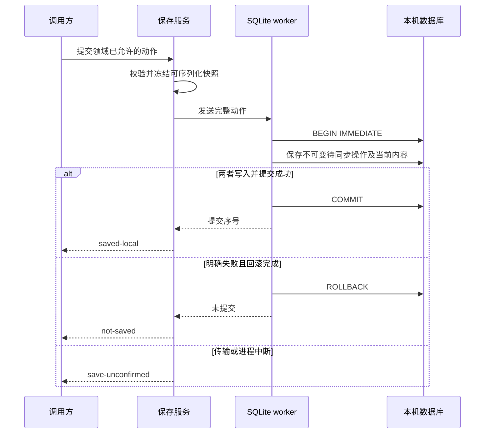

---
paths:
  - "packages/contracts/src/local-persistence.ts"
  - "packages/core/src/operations/**/*"
  - "packages/adapters/src/sqlite/**/*"
  - "tests/**/*"
---

# 本机内容持久保存

状态：N01 已实现并完成保存底座验收，2026-10-25；已按实际代码和测试校准。界面清空输入及联网传输将在后续节点接入时再验收。

## 保存事务与恢复

### 模块概览

Architecture：[共享核心](../architecture/core.md)、[基础设施适配器](../architecture/adapters.md)。PRD：[本机内容持久保存](../../../docs/prd/公共机制/统一进度保障/可靠保存与结果确认/本机内容持久保存/本机内容持久保存.md)。

本设计关注当前内容、删除进度与待同步操作的原子持久化，以及线程/进程中断后的结果含义。存储接收已获领域许可的通用动作，不定义待办字段或授予离线动作权限。

| 实现锚点 | 作用 |
|---|---|
| packages/contracts/src/local-persistence.ts | 保存端口及成功、失败、不确定结果契约 |
| packages/core/src/operations/local-content-service.ts | 序列化输入快照、调用保存端口、映射结果 |
| packages/adapters/src/sqlite/local-store.ts | 异步存储端口及 worker 生命周期 |
| packages/adapters/src/sqlite/worker.ts | 独立线程的请求执行 |
| packages/adapters/src/sqlite/database.ts | SQLite 连接、事务及恢复读取 |
| packages/adapters/src/sqlite/schema.ts | 存储格式及约束的事实源 |
| tests/integration/local-persistence.test.ts | 磁盘、故障及宿主验收 |
| scripts/test-electron.mjs | Electron 内置 Node 宿主验证入口 |

### API 概览

| 契约 | 方向 | 输入语义 | 输出语义 | 失败类别 |
|---|---|---|---|---|
| LocalContentService.save | 调用方 → 核心 | 当前空间及领域内的内容替换或删除 | 本机保存确认，或保留输入所需的明确状态 | 无效输入、未保存、保存尚不能确认 |
| LocalPersistence.commit | 核心 → 适配器 | 已序列化、带稳定操作身份的完整快照 | SQLite 提交后形成的本机序号 | 已知未提交、传输中断造成未知结果 |
| readRecord / listPending | 宿主 → 适配器 | 明确的空间、领域及内容范围 | 当前本机内容及不可变待同步操作 | 读取不可用必须报错，不返回伪空列表 |
| close | 宿主 → 适配器 | 停止接受后续请求 | 先完成已排队请求，再关闭资源 | 未完成请求保持可识别失败 |

具体类型、字段及 SQL 以源码为准，不在本文件复制 Schema。

### 数据模型

- 当前记录是本机成果，不是服务器已确认事实；删除为可持久化标记。
- 待同步操作保存当时动作及完整内容快照，后续修改不能反写之前的待同步材料。
- 当前记录与新增待同步材料处于同一数据库事务；只保存文字不构成成功。
- 空间和领域共同限定所有读取及内容主键；不同领域可使用相同内容 ID。
- 数据库具备独立应用标记及格式版本。未知应用数据库、未来格式及不一致格式拒绝打开，不覆盖或自动降级。
- 完整 DDL 及有效组合由 schema.ts 维护；N29–N30 后续加入的冲突事务及 v1→v2 迁移见 [冲突接续](conflicts.md)，权威同步游标和凭据存储仍待后续节点。

### 关键流程

saved-local 是后续界面可以清空输入的必要依据，不表示已同步。输入快照在异步发送之前形成，因此调用方后续修改对象不改变已提交材料。当前节点没有网络调用。

### 状态机与恢复

| 结果 | 语义 | 后续边界 |
|---|---|---|
| saved-local | 当前内容和待同步材料已提交 | 可继续记录；未表示服务器确认 |
| not-saved | 无效输入、提交前不可用或完整回滚 | 保留当前输入及此前成果，不能上传该次动作 |
| save-unconfirmed | 请求已发送但没有可信提交结果，或提交失败后不能确认回滚 | 保留输入与原操作身份，交 N02 结果核对；禁止当作一次新操作盲重试 |

应用重新打开读取已提交材料；SQLite 恢复未提交事务，不能把半份成果变成成功。同 ID 的等价动作直接返回原回执；不一致动作明确拒绝；结果不明通过 [N02 结果核对](local-operation-recovery.md) 处理。

### 一致性、并发与幂等

单个连接由专用 worker 串行处理；数据库写事务用 SQLite 写锁序列化。异步端口让调用者不执行同步磁盘操作。写事务不包含网络、窗口或文件交付副作用。

事务提交采用 FULL 持久性配置和 WAL 日志；关闭不作为保存成功的必要步骤。真实断电仍依赖磁盘与系统兑现刷新语义，不用正常 close 测试代替中断恢复验证。

### 异常处理

- 数据库无法打开、只读或容量/约束等写错误不返回保存成功。
- 请求尚未派发时已关闭可明确未保存；派发后 worker 退出只能判为尚不能确认。
- 读失败不能冒充无记录；初始化失败关闭句柄并拒绝当前打开请求。
- 不把 SQLite 堆栈或内容载荷放入用户结果。诊断原因可作为内部错误 cause 保留。
- schema 初始化在事务内完成；已有不兼容库不执行建表覆盖。

### 监控与测试

使用真实临时目录与实际 SQLite，不以内存仓库代替。验证新增、更新、删除、隔离、不可变待同步、同事务失败、只读错误、正常重启、提交成功后强制终止进程、未提交事务终止恢复及两个宿主的运行。

Electron 测试以 ELECTRON_RUN_AS_NODE 运行其内置 Node 并执行同一磁盘测试集；这是宿主兼容性验证，不是桌面界面、安装包或 renderer 桥接的验收。2026-10-25 验证：接入 N02 后，Node.js 22.23.0 和 Electron 45.0.0（内置 Node 24.22.0）各通过 30 项；包依赖边界及 TypeScript 检查通过，演示实际完成保存、关闭、重开和读取。

### 关键技术决策

选用运行时内置 node:sqlite，避免额外原生模块的 Electron ABI 重编译；具体支持由当前 Node 与 Electron 实测决定。同步 SQLite API 限定在 worker 内。Node 22 中该模块仍有实验性标记，因此版本固定、适配器隔离，并在运行时升级时重新执行两宿主测试；不把该驱动接口暴露为领域 API。

参考：[Node 22.23 SQLite](https://nodejs.org/download/release/v22.23.0/docs/api/sqlite.html)、[Electron 环境变量](https://www.electronjs.org/docs/latest/api/environment-variables)。

