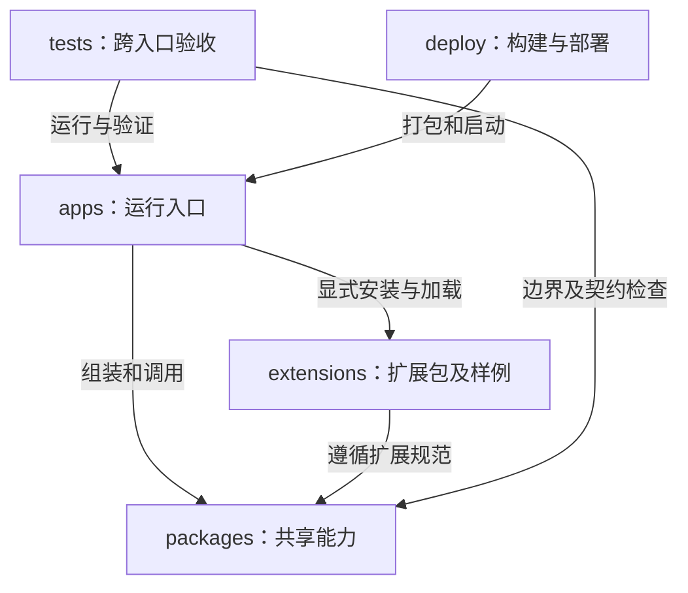

---
paths:
  - "**/*"
---

# Architecture：个人信息统一工作空间

状态：v0.1 架构基线已于 2026-10-25 经用户确认。当前实现已推进至 N62，包含同步及待办整合、MCP 授权与动作、双来源快照和文件交付、空白目标隔离恢复、明确迁移切换及 Windows 便携客户端/独立 Node 服务材料。实际检查及平台范围见 [交付验收](交付验收.md)。

输入：[PRD 骨架与实现队列](PRD.md)、[整体范围与验收](prd/个人信息统一工作空间/个人信息统一工作空间.md)、[MRD](MRD.md)。

## 项目根

### 架构图

图中是根目录直接下级的规划职责；运行进程、模块内部结构分别在下级文档展开。既有 docs、.agents 和 AGENTS.md 继续承担文档与开发规范职责。

### 定位与职责

组织 Windows 桌面入口、权威服务入口和 MCP 接入入口，使它们共享领域语义，并保持设备本机状态、工作空间事实和外部调用权限的边界。

关联 PRD：个人信息统一工作空间、多端记录与持续推进、信息领域管理、数据自主与迁移、MCP工具接入、统一进度保障。

### 内部组成

| 规划目录 | 职责 | 下级架构 |
|---|---|---|
| apps/ | 已建立 desktop 保存状态/空间创建入口及 server 初始化服务；mcp 已实现 stdio 桥接 | [运行入口](../.claude/rules/architecture/apps.md) |
| packages/ | 已建立 contracts、core、SQLite adapters 与 ui 状态组件；其他包按队列加入 | [共享包](../.claude/rules/architecture/packages.md) |
| extensions/ | 用户扩展规范对应的独立样例和打包材料 | [扩展交付](../.claude/rules/architecture/extensions.md) |
| tests/ | 跨入口、跨设备与故障恢复验收 | [测试与交付](../.claude/rules/architecture/delivery.md) |
| deploy/ | Windows 桌面交付及 Ubuntu/Windows 自管服务安装启动材料 | [测试与交付](../.claude/rules/architecture/delivery.md) |

### 依赖与联动

- apps 只在各自组装入口选择适配器；入口之间通过版本化协议协作，不相互导入内部模块。
- packages 不依赖 apps、tests 或 deploy；todo-list 的业务含义只归独立领域包，其他领域不继承该包。
- 同一工作空间只有一个活动权威服务。客户端可保存本机成果与待同步操作，本机副本不因此成为第二个权威服务。
- 本机创建也运行同一个 server 入口，默认仅在回环地址提供服务；它与桌面副本使用不同数据目录。桌面受理先保存本机成果，再提交权威服务，因此远端不可达和本机服务暂不可用时沿同一路径接续。
- MCP 通过服务入口操作权威事实；桌面人工操作先经过本机受理，再由同一权威业务执行器确认。MCP 不绕过领域校验，也不写桌面副本冒充服务器成功。

### 架构级约束与不变量

| 约束 | 保护目标与范围 | 保障方式 |
|---|---|---|
| 领域内容身份始终带有空间及领域归属 | 所有入口及持久化隔离 | 契约校验、隔离集成测试 |
| 外部入口只能通过应用能力执行写入 | apps、共享核心、持久化适配器的所有权 | 包依赖检查、无原始 SQL 的入口契约 |
| 本机受理、权威确认和结果不明不能合并为同一成功 | 桌面、同步、MCP 的结果一致性 | 故障注入和跨入口测试 |
| 权威操作结果及其必要来源记录作为一致提交保留 | 服务、存储、MCP调用记录 | 事务边界及断点恢复测试 |
| 扩展登记与启用属于工作空间；扩展程序可用性属于具体主机 | 同步、扩展、导出恢复 | 两主机安装状态测试 |
| 恢复与迁移不自动开放第二个可写权威服务 | 服务、携带数据、部署 | 恢复隔离门禁、旧端停写验收 |
| 不将 UI 投影或客户端缓存当作完整备份 | 界面、存储、导出 | 来源标识和快照完整性验收 |

### 技术选型

以下技术选择已随架构基线确认；依赖版本由进入实现的节点锁定并验证。

| 选择 | 用途及理由 | 替代方案与边界影响 |
|---|---|---|
| TypeScript 单仓库、pnpm workspace | 共享领域、契约与工具声明，减少多个入口重复业务 | 相比多语言首版更易保持一致；核心不引用 Node、Electron 或 React |
| Electron + React | Windows 悬浮窗口和工作空间界面 | 相比 WPF 保留 macOS 桌面复用；相比 Tauri 首版减少 Rust/JS 双栈。安装体积与内存有成本，不能宣称轻量 |
| Node.js 受支持 LTS + HTTP 服务 | 本机及自管服务器使用同一应用宿主 | 不依赖专有云服务。HTTP 框架、补丁版本及打包锁定在进入实现时验证 |
| SQLite | 桌面副本及单实例权威存储，支持事务和一致快照 | 首版不需要外部数据库运维；数据库仅由所属进程访问，不通过网络共享数据库文件 |
| 官方 TypeScript MCP SDK、stdio 桥接 | 外部 Agent 启动本机 MCP 进程，桥接访问本机或远端权威服务 | 首版不必对公网直接暴露 MCP 端点；Streamable HTTP 可在后续独立适配，不声称本轮已交付 |
| 声明式自定义扩展包 | 以领域声明、数据校验、视图和动作声明组成可安装程序材料 | 首版建议不执行第三方任意 Node.js/原生代码；限制及演进见扩展架构，属于此次需审阅的结构选择 |

Android 不能运行 Electron。后续 Android 需独立客户端与本机存储适配器；可复用协议与不依赖宿主的领域规则，但没有本轮原生 Android 支持承诺。macOS 桌面也须单独构建及验收。

N01 选用适配器内封装的 node:sqlite，已在 Node.js 22.23.0 和 Electron 45.0.0 的内置 Node 24.22.0 上通过同一磁盘测试集，SQLite 均运行在 worker 内。Node 22 的此模块带实验性标记，升级时须回归；Windows 安装包及 renderer 桥接仍待后续节点验收。

### 非功能约束

- 客户端快速受理不等待远端；数据库和备份的大量工作不得阻塞界面线程。
- 跨设备同步延迟按 PRD 的正常条件目标验收；重试调度和批量策略在相关 JIT TDD 定义。
- 凭据不进入普通日志、渲染层或可恢复的旧授权效力；公开网络访问通过 TLS 与独立认证边界。
- 服务按个人空间的单实例写入设计，不引入分布式多主或容器横向扩容数据库写入。
- 运行诊断只留必要关联信息；业务调用记录由核心拥有，不能只依赖进程日志。

### 实现衔接

保持 PRD 的 N01–N62 顺序。N01 事务持久化、N02 本机幂等与核对、N03 状态投影已实现；N04 已验证三者的共享保存闭环及完整应用重启，当前契约见 [JIT TDD 导航](TDD.md)。后续节点只在进入实现时补充其契约与技术语义，不提前编写整个项目的字段、接口或数据库设计。

### 选型依据

- [Electron BrowserWindow](https://www.electronjs.org/docs/latest/api/browser-window)：窗口行为由桌面壳拥有。
- [Electron 安全指南](https://www.electronjs.org/docs/latest/tutorial/security)：渲染进程隔离及桥接边界的依据。
- [Node.js 发布维护说明](https://nodejs.org/en/about/previous-releases)：运行时选择受支持的 LTS，具体版本在锁依赖时确认。
- [SQLite 适用场景](https://www.sqlite.org/whentouse.html)与[原子提交](https://www.sqlite.org/atomiccommit.html)：本地事务存储的选型依据。
- [MCP 传输规范](https://modelcontextprotocol.io/specification/2025-11-25/basic/transports)与[官方 TypeScript SDK](https://github.com/modelcontextprotocol/typescript-sdk)：stdio 桥接的依据。引用版本只作设计参考，实际协商及客户端支持须实测。

